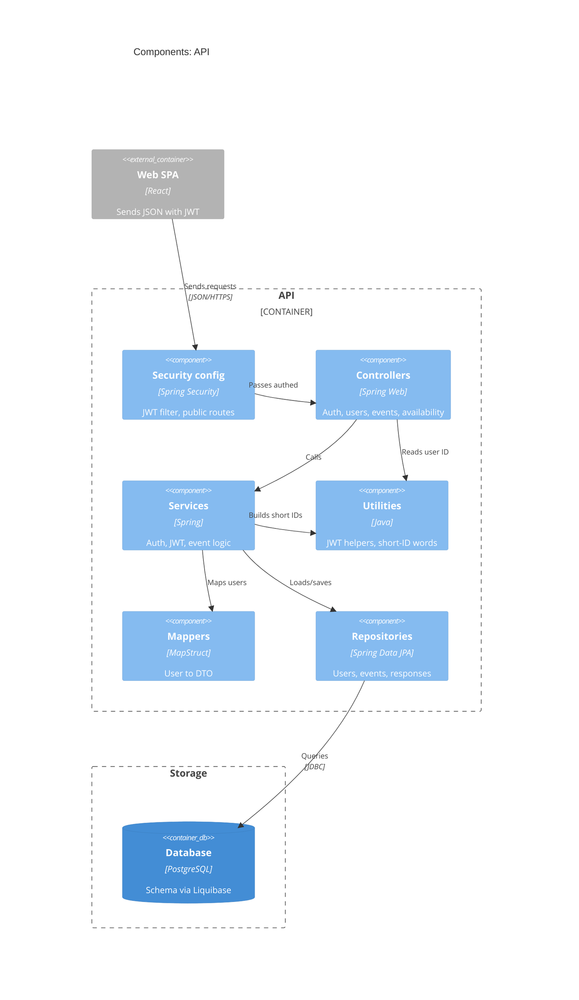

<!-- generated from cc3503d80c4e, 2026-05-06 -->
<!-- c4-map config e854e651d5aa -->

# Components: API

Packages inside the Spring Boot API (`com.gatherr.backend`). Drawn from [docs/c4/level-3.md](../c4/level-3.md). Sibling: [SPA components](c4-components-web.md). Up: [containers](c4-containers.md).

Not drawn, because nearly everything uses them: **DTOs** (`dto`, request/response payloads) and **Model** (`model`, JPA entities `User`, `Event`, `EventUser`). `DataSeeder` seeds dev data through the repositories.

Public routes (`SecurityConfig.java`): `POST /auth/google`, `GET /events/{shortId}`, `GET /events/{shortId}/summary` and Swagger. Everything else needs the API JWT.
