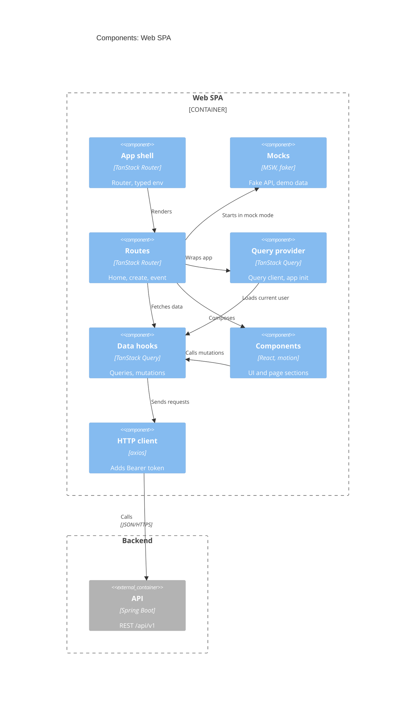

<!-- generated from cc3503d80c4e, 2026-05-06 -->
<!-- c4-map config e854e651d5aa -->

# Components: Web SPA

Top-level folders of `frontend/src`. Drawn from [docs/c4/level-3.md](../c4/level-3.md). Sibling: [API components](c4-components-api.md). Up: [containers](c4-containers.md).

Not drawn: **API types** (`api/types.gen.ts`, generated from the API's OpenAPI spec), used by data hooks and components, and the small helpers in `lib` (`utils`, `timezone`, `site`) used across routes and components.

