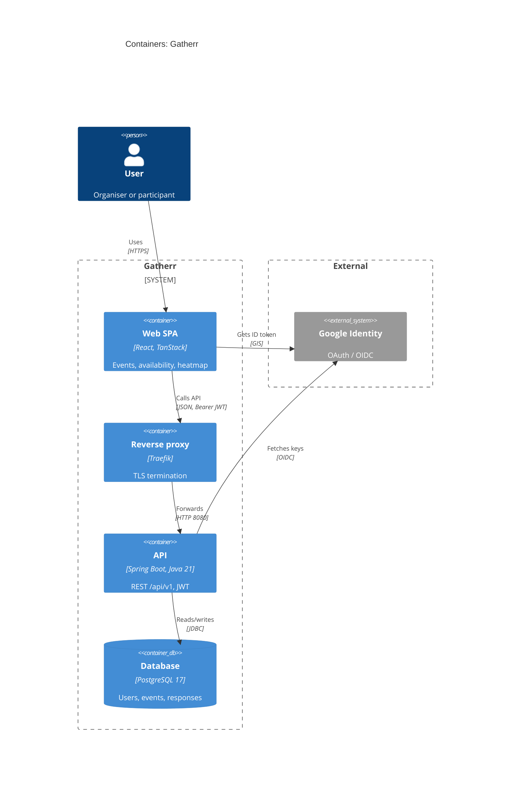

<!-- generated from cc3503d80c4e, 2026-05-06 -->
<!-- c4-map config e854e651d5aa -->

# Containers: Gatherr

What runs in production and how the pieces talk. Drawn from [docs/c4/level-2.md](../c4/level-2.md). Up: [context](c4-context.md). Inside the containers: [API components](c4-components-api.md), [SPA components](c4-components-web.md). Hosting: [deployment](c4-deployment.md).

- The SPA signs in with Google, sends the ID token to `POST /auth/google`, and gets back the API's own JWT, kept in `localStorage`.
- With `VITE_ENABLE_MOCK=true` the SPA runs against MSW mocks instead of the API.
