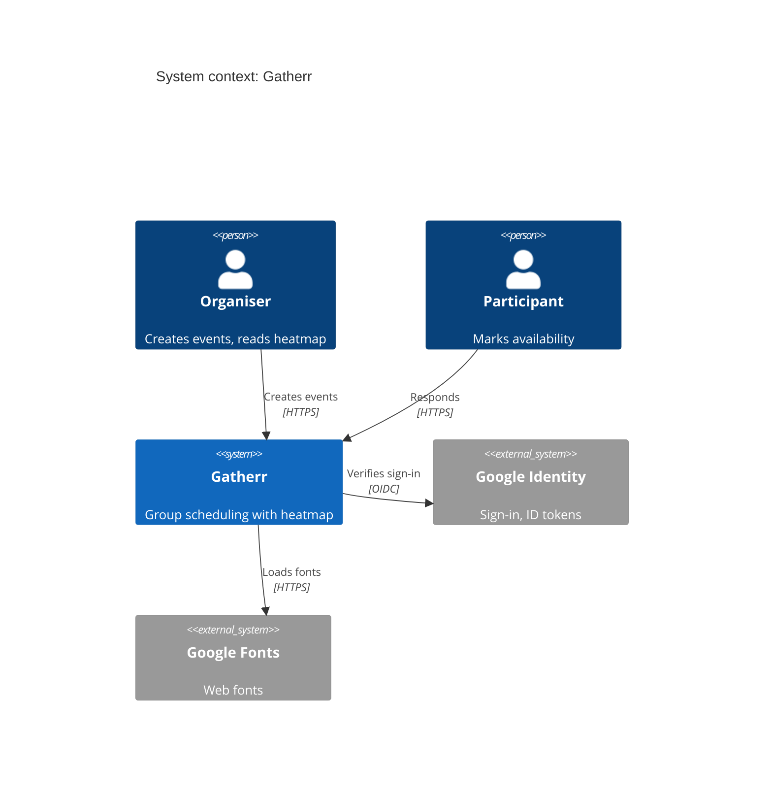

<!-- generated from cc3503d80c4e, 2026-05-06 -->
<!-- c4-map config e854e651d5aa -->

# System context: Gatherr

Who uses Gatherr and which outside systems it depends on. Drawn from [docs/c4/level-1.md](../c4/level-1.md). Next level down: [containers](c4-containers.md).

Google is the only way to sign in. Google Calendar import is planned (PRs #68 and #69) but not yet live.
