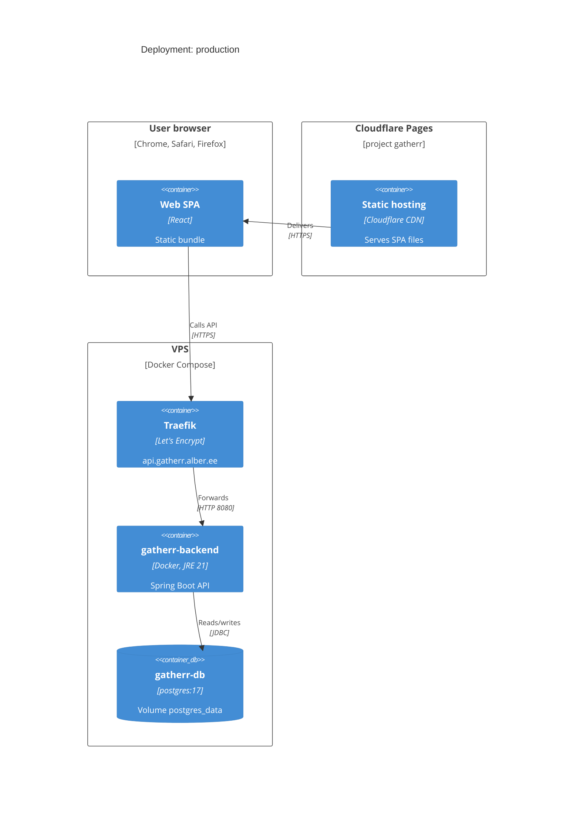

<!-- generated from cc3503d80c4e, 2026-05-06 -->
<!-- c4-map config e854e651d5aa -->

# Deployment: production

Where each container runs. Built from `.github/workflows/deploy-*.yml` and `docker-compose.prod.yml`. Up: [containers](c4-containers.md).

- Push to `main` touching `backend/` builds the image to Docker Hub, copies `docker-compose.prod.yml` to `/my-apps/gatherr/` over SSH, writes `.env` from the `ENV_FILE` secret, and runs `docker compose up -d`.
- Push to `main` touching `frontend/` runs `npm run build` and `wrangler pages deploy`.
- The API and database share the `internal` network; only the API joins Traefik's `proxy` network.
