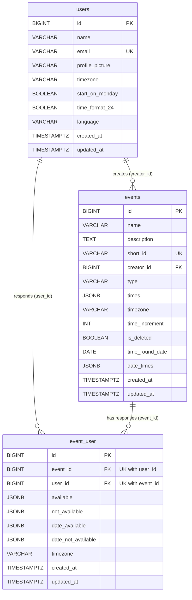

<!-- generated from cc3503d80c4e, 2026-05-06 -->
<!-- c4-map config e854e651d5aa -->

> **Agent context map.** Dense on purpose and not laid out for viewing; labels may overlap when rendered. Diagrams for people: [docs/architecture/](../architecture/).

# Database

Written by hand from the Liquibase changelog `backend/src/main/resources/db/changelog/db.changelog-master.yaml` (changesets 001-006 and 010; it is YAML, not SQL, so `render-db` does not apply). Columns only: no defaults or checks. PK primary key, FK foreign key, UK unique.

- Indexes on `events.short_id` and `events.creator_id` (changeset 004).
- `events.type` holds `EventType` (`SPECIFIC_DATES_AND_TIMES`, `SPECIFIC_DATES`, `WEEKDAYS_AND_TIMES`, `WEEKDAYS`); `times`, `available` and `not_available` are JSON arrays of slot keys in that type's format (see issue #77).
- Events are soft-deleted (`is_deleted`).
- Two-step events (#94, changeset 010): a `SPECIFIC_DATES` event is in the date round while `time_round_date` is null. Starting the time round sets `time_round_date`, moves the dates to `date_times`, replaces `times` with that day's `HHmm-ddMMyyyy` slots and `type` with `SPECIFIC_DATES_AND_TIMES`, and moves each `event_user`'s `available`/`not_available` to `date_available`/`date_not_available` (read-only after that). One way: nothing clears `time_round_date`.
