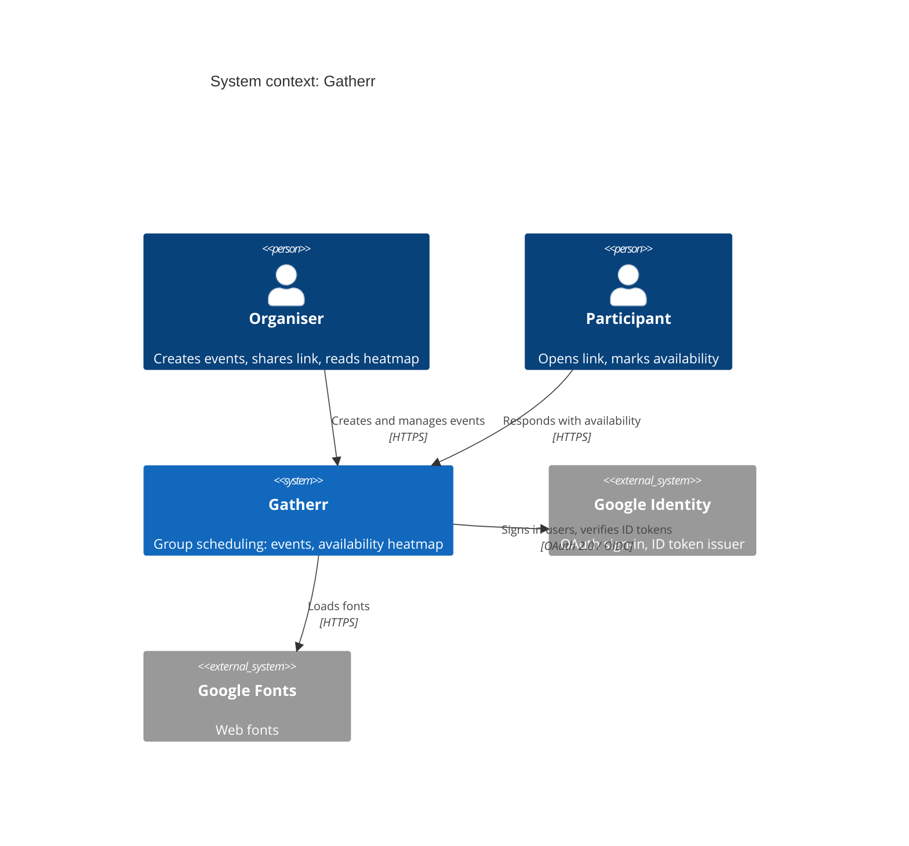

<!-- generated from cc3503d80c4e, 2026-05-06 -->
<!-- c4-map config e854e651d5aa -->

> **Agent context map.** Dense on purpose and not laid out for viewing; labels may overlap when rendered. Diagrams for people: [docs/architecture/](../architecture/).

# Level 1: System context

Gatherr lets an organiser create an event with candidate times, share a short link, and see participants' availability as a heatmap (`SoW.md`, `frontend/src/routes`).

- Google is the only sign-in method. The SPA gets a Google ID token via `@react-oauth/google`; the API verifies it against issuer `https://accounts.google.com` and audience `GOOGLE_CLIENT_ID` (`backend/.../config/JwtConfig.java`), then issues its own JWT.
- `google-api-services-calendar` is in `backend/pom.xml` but no main code calls it yet (Google Calendar import is open work, PRs #68/#69).
