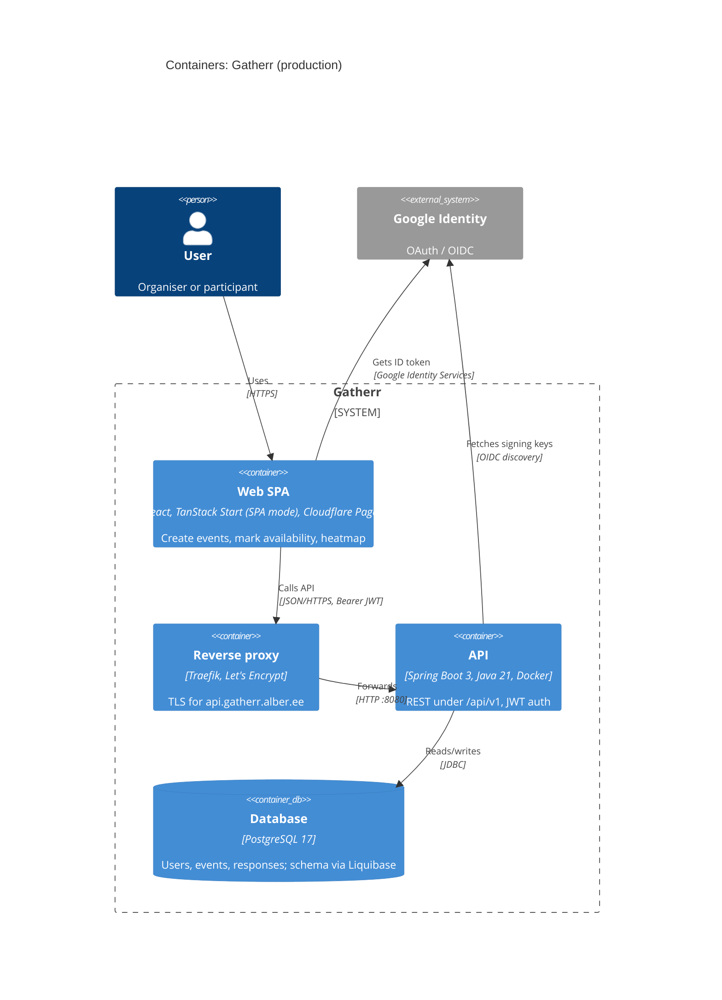

<!-- generated from cc3503d80c4e, 2026-05-06 -->
<!-- c4-map config e854e651d5aa -->

> **Agent context map.** Dense on purpose and not laid out for viewing; labels may overlap when rendered. Diagrams for people: [docs/architecture/](../architecture/).

# Level 2: Containers

Production: a static SPA on Cloudflare Pages calls a Spring Boot API on a VPS behind Traefik, which stores everything in PostgreSQL (`.github/workflows/deploy-*.yml`, `docker-compose.prod.yml`).

- SPA build: `VITE_API_URL=https://api.gatherr.alber.ee/api/v1` (`deploy-frontend.yml`). With `VITE_ENABLE_MOCK=true` the SPA uses MSW (`frontend/src/mocks`) and calls `/api/v1` locally instead of the API.
- Auth: the API JWT is kept in `localStorage` (`token`) and sent as `Authorization: Bearer` by `frontend/src/lib/axios.ts`.
- Deploy: push to `main` builds the API image to Docker Hub and runs `docker compose -f docker-compose.prod.yml up` on the VPS over SSH; the SPA deploys with wrangler. CI on PRs runs `./mvnw verify` (`verify-backend.yml`).
- Local dev: `docker-compose.yaml` runs Postgres + API (`Dockerfile.dev`, mounts `frontend/` to generate `frontend/src/api/types.gen.ts` from OpenAPI); the SPA runs with `npm run dev` on :3000.
