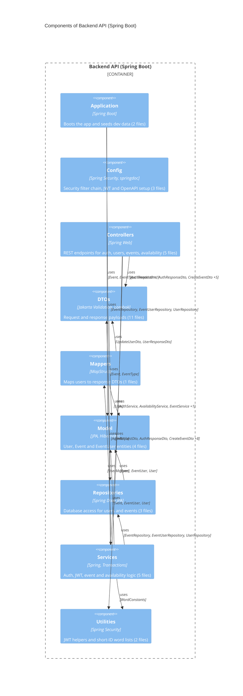
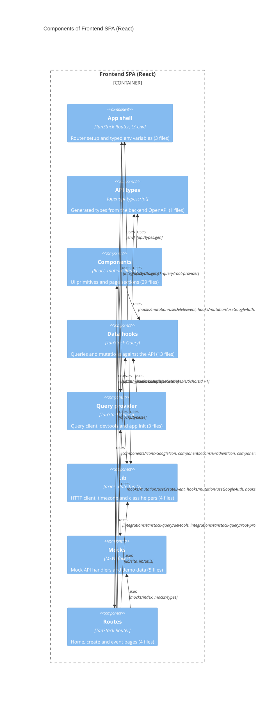

<!-- generated from cc3503d80c4e, 2026-05-06 -->
<!-- c4-map config e854e651d5aa -->

> **Agent context map.** Dense on purpose and not laid out for viewing; labels may overlap when rendered. Diagrams for people: [docs/architecture/](../architecture/).

# Level 3: Components

Generated from source imports. A component is a directory (or package) at the configured depth; an arrow means code in one component imports the other, labelled with what it imports. Container context: [level-2.md](level-2.md).

## Backend API (Spring Boot)

Root `backend/src/main/java`, depth 1.

## Frontend SPA (React)

Root `frontend/src`, depth 1.

